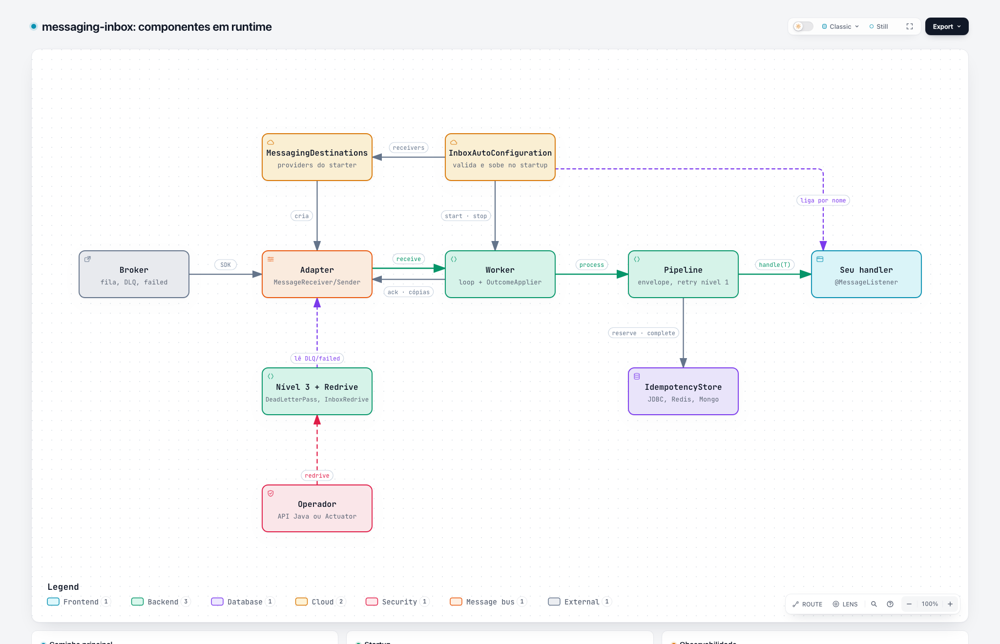
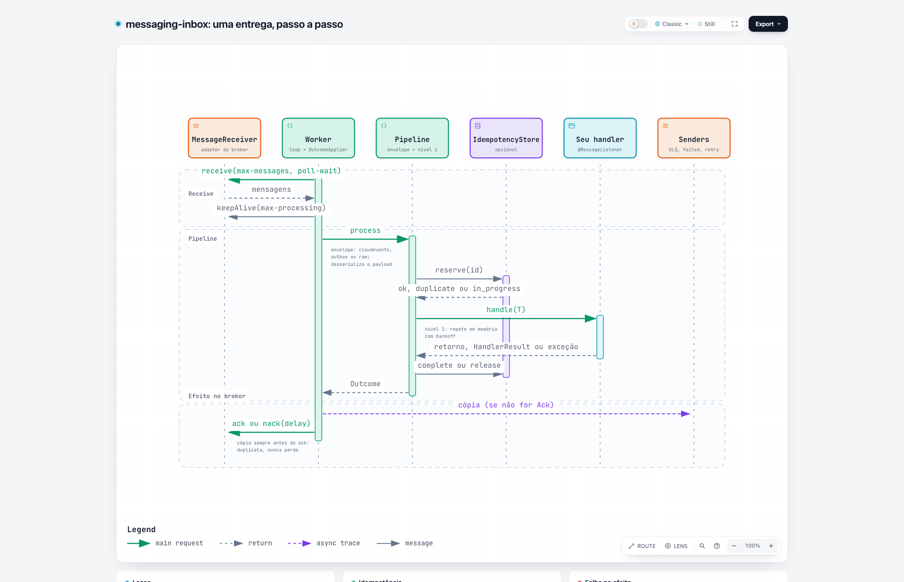
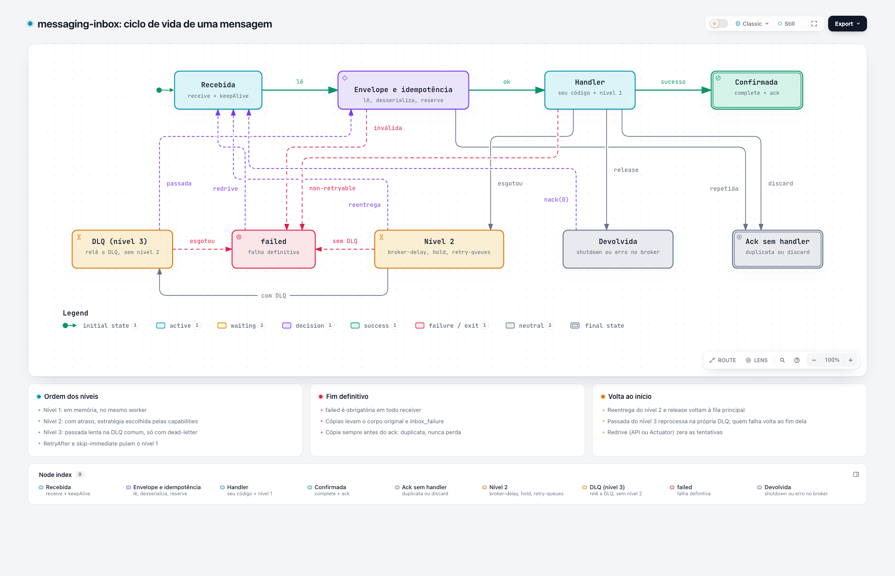

# messaging-inbox

Consumo de mensagens com **retry, DLQ, idempotência e métricas iguais em todos os brokers** da messaging-lib: SQS
(e SNS via SQS), Service Bus, Pub/Sub, ActiveMQ Classic, Artemis e RabbitMQ. Você escreve só o handler; a inbox faz
o loop de `receive`, renova o lease, tenta de novo quando dá erro e manda para uma fila de falha quando desiste.

> Versão 0.x, em desenvolvimento. O que já existe e o que falta está em [Status](#status-implementado-e-todo).
> Decisões em [`docs/adr/`](docs/adr/) e plano em [`docs/plan.md`](docs/plan.md).

- [Conceitos em 2 minutos](#conceitos-em-2-minutos)
- [Primeiros passos](#primeiros-passos)
- [Escrevendo o handler](#escrevendo-o-handler)
- [Configuração completa](#configuração-completa)
- [Retry em três níveis](#retry-em-três-níveis)
- [Idempotência](#idempotência)
- [Redrive: reprocessar depois de corrigir um bug](#redrive-reprocessar-depois-de-corrigir-um-bug)
- [Topologia no broker](#topologia-no-broker)
- [Métricas e tracing](#métricas-e-tracing)
- [Shutdown](#shutdown)
- [Erros comuns no startup](#erros-comuns-no-startup)
- [Status: implementado e TODO](#status-implementado-e-todo)

## Conceitos em 2 minutos



Versão interativa: [`docs/diagramas/arquitetura.html`](docs/diagramas/arquitetura.html) (abra no navegador).

| Termo | O que é |
|---|---|
| **receiver** | Uma fila (ou subscription de tópico) que você consome. Cada um tem um nome em `messaging.receivers.<nome>`. |
| **handler** | O seu código. Recebe o payload já desserializado. Terminou sem exceção = mensagem confirmada (`ack`). |
| **envelope** | O formato da mensagem: CloudEvents, body da outbox-library ou raw. A inbox detecta sozinha (`envelope: auto`). |
| **worker** | Uma thread que faz `receive` → handler → `ack` em loop. `concurrency` define quantos. |
| **lease** | Tempo que o broker esconde a mensagem dos outros consumers. A inbox renova (`keepAlive`) enquanto o handler roda. |
| **`failed`** | Fila comum (obrigatória) para onde vão as mensagens que a inbox desistiu de processar, com o body original. |
| **`dead-letter`** | Fila comum (opcional) onde a mensagem espera para uma nova rodada de tentativas (nível 3). |
| **redrive** | Devolver mensagens da `failed` (ou da DLQ) para a fila principal, depois de corrigir o bug. |

Uma entrega, passo a passo ([interativo](docs/diagramas/sequencia-entrega.html)):



## Primeiros passos

### 1. Dependências

Use o `messaging-bom` (com o BOM do Spring Boot 4) e adicione o starter, a inbox, o adapter do seu broker e o Jackson 3:

```xml
<dependencyManagement>
  <dependencies>
    <!-- o BOM do Spring Boot vem antes dos BOMs dos SDKs (ADR-0008 da messaging-lib) -->
    <dependency>
      <groupId>com.example</groupId>
      <artifactId>messaging-bom</artifactId>
      <version>0.1.0-SNAPSHOT</version>
      <type>pom</type>
      <scope>import</scope>
    </dependency>
  </dependencies>
</dependencyManagement>

<dependencies>
  <dependency>
    <groupId>com.example</groupId>
    <artifactId>messaging-spring-boot-starter</artifactId>
  </dependency>
  <dependency>
    <groupId>com.example</groupId>
    <artifactId>messaging-inbox</artifactId>
  </dependency>
  <dependency>
    <groupId>com.example</groupId>
    <artifactId>messaging-aws</artifactId>   <!-- ou messaging-azure, -gcp, -jms, -rabbitmq -->
  </dependency>
  <dependency>
    <groupId>org.springframework.boot</groupId>
    <artifactId>spring-boot-jackson</artifactId>   <!-- Jackson 3; versão do BOM do Spring Boot -->
  </dependency>
  <!-- opcional, só com idempotency.enabled: true; fora do messaging-bom, informe a versão -->
  <dependency>
    <groupId>com.example.idempotency</groupId>
    <artifactId>idempotency-spring-boot-starter</artifactId>
    <version>${idempotency.version}</version>
  </dependency>
</dependencies>
```

> **Atenção:** sem Jackson 3 (`tools.jackson.databind`) no classpath, a autoconfiguração da inbox **não sobe e não
> avisa**. Se nenhum receiver consome, confira isso primeiro.

### 2. Configuração mínima

```yaml
messaging:
  providers:
    aws:
      type: aws
      region: sa-east-1
  receivers:
    billing-orders:
      destination: orders          # nome ou URL da fila
      failed: orders-failed        # obrigatória
```

As filas `orders` e `orders-failed` precisam existir: a lib não cria recursos (crie com Terraform ou com o
`localstack-init.sh`).

### 3. Handler

```java
@Component
class BillingListener {

    @MessageListener(receiver = "billing-orders")
    void on(OrderCreated order) {
        billing.register(order);   // terminou sem exceção: ack
    }
}
```

Pronto. Com esses padrões, uma exceção faz a mensagem ser tentada mais 3 vezes em memória; se continuar falhando,
ela volta com atraso (cerca de 30 s, 1 min, 2 min, 4 min, 8 min), e cada volta repete as 3 tentativas em memória. No
fim vai para `orders-failed`. No pior caso o handler roda **24 vezes** para a mesma mensagem (36 com o nível 3), e
toda mensagem pode chegar duplicada: **o handler precisa ser idempotente** (ou ligue a [idempotência](#idempotência)).

## Escrevendo o handler

Há dois jeitos, e cada receiver precisa de **exatamente um** handler (zero ou dois derrubam o startup).

### Por anotação

```java
@MessageListener(receiver = "billing-orders")
void on(OrderCreated order) { ... }                                  // só o payload

@MessageListener(receiver = "billing-orders")
void on(OrderCreated order, InboxMessage message) { ... }            // payload + metadados

@MessageListener(receiver = "billing-orders")
void on(TypedMessage<OrderCreated> message) { ... }                  // os dois juntos

@MessageListener(receiver = "billing-orders")
HandlerResult on(OrderCreated order) { ... }                         // resultado explícito (abaixo)
```

O payload é desserializado com o `JsonMapper` da aplicação. Com `String` ou `byte[]`, chega cru.

### Funcional (bean)

O nome do bean é o nome do receiver, igual (`billing-orders`) ou em camelCase (`billingOrders`):

```java
@Bean
InboxHandler<OrderCreated> billingOrders(Billing billing) {
    return message -> billing.register(message.payload());
}

// ou, com resultado explícito:
@Bean
InboxResultHandler<OrderCreated> billingOrders(Billing billing) {
    return message -> billing.tryRegister(message.payload())
            ? HandlerResult.ack()
            : HandlerResult.discard("pedido antigo");
}
```

### O que vem em `InboxMessage`

| Campo | Origem |
|---|---|
| `id()` | id do envelope (CloudEvents `ce_id`, `messageId` da outbox, ou o id do broker). É a chave de idempotência. |
| `type()`, `source()`, `time()`, `subject()` | Do envelope, quando existem |
| `aggregateType()`, `aggregateVersion()` | Da outbox ou de `ce_aggregateversion` |
| `traceparent()` | Contexto W3C para continuar o trace |
| `headers()` | Atributos do transporte e `headers` da outbox, sem os `inbox_*` |
| `payload()` / `payloadAsString()` | Bytes do payload (na outbox, só o campo `payload`) |
| `delivery()` | Em que nível de retry e tentativa a mensagem está |

### Controlando o que acontece com a mensagem

O normal é só lançar exceção. Quando precisar de mais controle, devolva um `HandlerResult`:

| Retorno | Efeito |
|---|---|
| `void`, ou `HandlerResult.ack()` | Confirma |
| exceção | Retry (níveis 1, 2 e 3), depois `failed` |
| `HandlerResult.retryAfter(Duration.ofMinutes(1))` | Pula o nível 1 e agenda o próximo retry com esse atraso |
| `HandlerResult.reject("motivo")` | Vai direto para `failed`, sem retry |
| `HandlerResult.discard("motivo")` | Confirma sem processar; métrica `outcome=discarded` |

Para classificar exceções sem mexer no handler:

```java
@NonRetryable                           // vai direto para failed
class InvalidOrderException extends RuntimeException { }

@SkipImmediate                          // pula o nível 1 (ex.: rate limit, não adianta tentar em 100 ms)
class RateLimitedException extends RuntimeException implements RetryAfterHint {
    private final Duration retryAfter;
    RateLimitedException(Duration retryAfter) { this.retryAfter = retryAfter; }
    @Override public Duration retryAfter() { return retryAfter; }   // ex.: header Retry-After do HTTP
}
```

A classificação olha a cadeia de causas, então uma exceção embrulhada (`new RuntimeException(e)`) é classificada
pela causa. O mesmo vale pela configuração: `retry.non-retryable`, `retry.skip-immediate` e `retry.retryable`
(allowlist: só essas são retentadas).

## Configuração completa

O arquivo [`docs/exemplos/application-completo.yaml`](docs/exemplos/application-completo.yaml) tem **todas** as chaves
aceitas hoje, com comentários e os valores padrão. Ele é carregado por um teste (`DocumentedConfigTest`), então não
fica desatualizado.

Como as chaves se combinam, da maior para a menor prioridade:

1. `messaging.receivers.<nome>.<chave>`
2. `messaging.receiver-defaults.<chave>`
3. o padrão da biblioteca

Isso vale chave a chave: dá para mudar só `retry.immediate.initial` nos defaults e manter o resto.

| Chave | Padrão | Para que serve |
|---|---|---|
| `destination` | — (obrigatória) | Fila, ou tópico com `subscription`. Formato por provedor: [README raiz](../README.md#spring-boot) |
| `subscription` | — | Receber de um tópico (Service Bus, ActiveMQ, RabbitMQ) |
| `provider` | o único | Nome em `messaging.providers` |
| `options` | — | Opções do provedor (`sessions`, `ack-deadline`, `lease`, `require`...) |
| `failed` | — (obrigatória) | Fila de falha definitiva |
| `dead-letter` | — | DLQ comum; liga o nível 3 |
| `enabled` | `true` | `false`: validado, mas não consome |
| `concurrency` | `1` | Workers por receiver |
| `max-messages-per-poll` | `1` | Mensagens por `receive` |
| `poll-wait` | `20s` | Espera máxima do `receive` |
| `key-lanes` | `1` | Paralelismo por `orderingKey` dentro de um `receive` (precisa de `max-messages-per-poll` > 1) |
| `max-processing` | `15m` | Quanto o lease é renovado por mensagem |
| `shutdown-timeout` | `30s` | Espera pelos handlers no shutdown |
| `ordering` | `relaxed` | `strict`: exige broker com ordem (FIFO, sessions, Pub/Sub ordenado) |
| `envelope` | `auto` | `cloudevents`, `outbox`, `raw` |
| `idempotency.enabled` | `false` | Liga a deduplicação |
| `idempotency.ttl` | `P7D` | Quanto tempo um id concluído é lembrado |
| `idempotency.reservation-ttl` | `max-processing` + esperas do `hold` + 5 min | Validade da reserva em andamento |
| `retry.immediate.*` | 3 tentativas, 100ms × 2 até 2s, jitter 0.2 | Nível 1 |
| `retry.delayed.*` | 5 tentativas, 30s × 2 até 15m, jitter 0.2, `strategy: auto` | Nível 2 |
| `retry.delayed.queues` | — | Faixas de `retry-queues` (`delay` + `destination`) |
| `retry.dead-letter.*` | 3 passadas, `interval` 15m, `max-per-pass` 100 | Nível 3 |
| `retry.non-retryable` | `PayloadDeserializationException`, `IllegalArgumentException` | **Substitui** a lista padrão (não soma) |
| `retry.skip-immediate` | vazia | Exceções que pulam o nível 1 |
| `retry.retryable` | vazia | Se preenchida, só essas são retentadas |
| `retry.include-exception-message` | `true` | Mensagem da exceção no atributo `dead_letter` das cópias |

Raiz `messaging`:

- `receivers-enabled: false` desliga todos os receivers (útil por ambiente: `${RECEIVERS_ENABLED:true}`).
- Chave desconhecida em qualquer nível **derruba o startup**, com a lista de todos os erros. As chaves antigas
  `inbox.*` e `messaging.destinations` também derrubam, com a indicação do que usar.

## Retry em três níveis



Versão interativa: [`docs/diagramas/ciclo-de-vida.html`](docs/diagramas/ciclo-de-vida.html).

| Nível | Onde | Padrão | Para quê |
|---|---|---|---|
| 1 — `immediate` | Em memória, no mesmo worker | 3 tentativas: ~100 ms, 200 ms, 400 ms | Falhas de milissegundos (timeout pontual) |
| 2 — `delayed` | Com atraso, pela estratégia | 5 tentativas: ~30 s, 1 min, 2 min, 4 min, 8 min | Dependência fora por minutos |
| 3 — `dead-letter` | Passada lenta na DLQ comum | 3 passadas a cada 15 min | Problema de horas; só com `dead-letter` |

No nível 3, cada instância relê a própria DLQ e roda o handler ali mesmo, com o nível 1 e sem o nível 2. Quem falha
volta para o fim da DLQ, até `retry.dead-letter.max-attempts` passadas; depois vai para `failed`. Uma passada termina ao
chegar em `max-per-pass` mensagens, numa mensagem mais nova que o início da passada ou numa chave repetida.
`max-attempts: 0` deixa a DLQ só como estacionamento.
| fim | `failed` | — | Ninguém mais tenta; redrive manual |

`max-attempts` conta as **tentativas extras**, não a primeira execução. O atraso é
`min(initial × multiplier^tentativa, max) × aleatório(1 − jitter, 1)`. Cada reentrega do nível 2 repete o nível 1.

### Estratégia do nível 2

Com `strategy: auto`, a inbox escolhe pelo que o broker suporta e loga a escolha no startup:

| Situação | Escolha |
|---|---|
| Broker com `nack` com atraso (SQS, Pub/Sub; Service Bus e ActiveMQ com `redelivery: reschedule`) | `broker-delay` |
| Sem atraso no broker e com `retry.delayed.queues` | `retry-queues` |
| Sem atraso e sem filas | `hold` |

- **`broker-delay`**: devolve com `nack(atraso)`. O broker conta as entregas.
- **`hold`**: segura a mensagem em memória (lease renovado) e tenta de novo no mesmo worker. Ocupa o worker durante a
  espera; prefira `max` curto.
- **`retry-queues`**: copia para uma fila de espera com TTL fixo (a menor faixa com `delay` maior ou igual ao atraso)
  e confirma a original. Quando o TTL vence, o broker devolve para a fila principal. Não preserva ordem.

Combinações que derrubam o startup: `ordering: strict` num broker sem ordem; `broker-delay` sem atraso no broker;
`retry-queues` sem `queues` ou com `strict`; `retry.delayed.max` acima do atraso máximo do broker (sem `max`
configurado, o starter limita sozinho).

### O que vai junto nas cópias

Toda cópia (DLQ, `failed`, retry-queue) leva o body original e os atributos:

- `inbox_attempts`: contagem por nível (`l2=;l3=;redrive=`), para a próxima rodada continuar de onde parou;
- `inbox_failure`: exceção e *fingerprint* (causa raiz + 5 frames, sem número de linha), usado para filtrar o redrive;
- `dead_letter`: motivo (com a mensagem da exceção, se `include-exception-message`).

A cópia é enviada **antes** do `ack` da original: num crash entre os dois, sobra uma duplicata, nunca uma perda. Por
isso o handler precisa tolerar duplicatas (ou ligue a idempotência). O broker aceita até 16 atributos por mensagem; o
produtor deve usar no máximo 14, para sobrar lugar para os da inbox.

## Idempotência

Opcional. Com ela, uma mensagem com o mesmo `id()` já processada é confirmada sem chamar o handler
(`outcome=duplicate`).

```yaml
idempotency:                 # da idempotency-spring-boot-starter
  store: jdbc                # jdbc | redis | mongo
messaging:
  receivers:
    billing-orders:
      idempotency:
        enabled: true
```

- Ordem: `reserve` → handler → `complete` (sucesso) ou `release` (qualquer outro resultado) → efeito no broker.
- Chave = id do envelope; escopo = nome do receiver (o nível 3 e o redrive usam o mesmo escopo).
- Duas instâncias com a mesma mensagem ao mesmo tempo: a segunda vê `in_progress` e reagenda pelo nível 2.
- Sem bean `IdempotencyStore`, o startup falha. Com o store em memória, sobe com aviso: ele não deduplica entre
  instâncias.

## Redrive: reprocessar depois de corrigir um bug

O fluxo típico:

1. Um bug manda mensagens para `orders-failed`.
2. Você corrige e implanta.
3. Faz um **dry run** para ver os grupos de erro (`byException`, `byFingerprint`) sem mover nada.
4. Faz o redrive filtrando pelo fingerprint do bug corrigido. As tentativas voltam a zero.

Pela API Java (bean `InboxRedrive`):

```java
@Autowired InboxRedrive redrive;

// 1) só olhar
RedriveReport preview = redrive.redrive(new RedriveRequest("billing-orders", Source.FAILED, Target.MAIN,
        1_000, null, 100, true));

// 2) mover só o que tem o fingerprint do bug, até 50 por segundo
RedriveReport report = redrive.redrive(new RedriveRequest("billing-orders", Source.FAILED, Target.MAIN,
        1_000, new Filter(null, "3f2a9c1e", null, null, null), 50, false));
```

`RedriveRequest(receiver, origem, destino, limite, filtro, maxPorSegundo, dryRun)`;
`Filter(exception, fingerprint, reason, enqueuedBefore, enqueuedAfter)`, com `null` para não filtrar.
Combinações aceitas: `failed` → principal, `failed` → DLQ e DLQ → principal. Num receiver de tópico, o destino
principal é recusado (chegaria a todas as subscriptions), e no Pub/Sub também (ele só envia a tópicos).

Pelo Actuator, o endpoint `inboxredrive` vem **desligado** e só liga com as duas chaves:

```yaml
management:
  endpoint.inboxredrive.access: unrestricted
  endpoints.web.exposure.include: health,inboxredrive
```

- `GET /actuator/inboxredrive`: receivers, origens disponíveis e destinos.
- `POST /actuator/inboxredrive/billing-orders` com
  `{"source":"failed","target":"main","limit":1000,"dryRun":true}`; opcionais: `maxPerSecond` (100), `exception`,
  `fingerprint`, `reason`, `enqueuedBefore`, `enqueuedAfter` (ISO-8601). Respostas: `400` pedido inválido, `404`
  receiver inexistente, `409` já existe uma execução em curso.

Proteger o endpoint é da aplicação:

```java
@Bean
SecurityFilterChain actuator(HttpSecurity http) throws Exception {
    return http.securityMatcher(EndpointRequest.to("inboxredrive"))
            .authorizeHttpRequests(a -> a.anyRequest().hasRole("OPERATOR"))
            .httpBasic(Customizer.withDefaults())
            .build();
}
```

## Topologia no broker

A lib não cria filas. Para cada receiver, crie a fila principal, a `failed` e, se usar, a DLQ e as filas de retry.

### DLQ nativa x orçamento da inbox

Se o broker tiver uma DLQ nativa (redrive policy, `MaxDeliveryCount`...), ela precisa agir **depois** da inbox, senão
a mensagem sai sem passar pela `failed`. Com `broker-delay`, a inbox usa até `1 + retry.delayed.max-attempts`
entregas (6 com os padrões), mais as de lease vencido ou shutdown; `hold` e `retry-queues` usam 1. Recomendação: o
limite nativo no dobro (12). Valores medidos pelo `InboxContract` com a configuração padrão de cada broker:

| Broker | Limite nativo padrão | Depois do limite | Nível 2 com `auto` |
|---|---|---|---|
| SQS | nenhum; só com redrive policy (`maxReceiveCount`) | DLQ da redrive policy | `broker-delay` |
| Service Bus (fila e subscription) | 10 entregas (`MaxDeliveryCount`) | DLQ nativa da entidade | `broker-delay` com `redelivery: reschedule` (só fila); senão `hold`/`retry-queues` |
| Pub/Sub | nenhum; só com dead-letter policy | tópico de dead letter | `broker-delay`; sem dead-letter policy, em memória como o `hold` (avisa no log) |
| ActiveMQ Classic | nenhum com este adapter | — | `broker-delay` com `redelivery: reschedule` (`schedulerSupport` no broker) |
| Artemis | 10 entregas (`max-delivery-attempts`) | endereço `DLQ` | `broker-delay` com `redelivery: reschedule` |
| RabbitMQ 4 (quorum) | 21 entregas (`delivery-limit` 20) | descartada, ou DLX | `hold` ou `retry-queues` |

Com o Service Bus ou o Artemis em `broker-delay`, suba `MaxDeliveryCount`/`max-delivery-attempts` para 12.

### RabbitMQ com `retry-queues`

Cada faixa é uma fila com TTL **da fila** (não da mensagem: o TTL por mensagem só expira na cabeça da fila e trava as
de trás) e dead-letter de volta para a principal:

```bash
rabbitmqadmin declare queue name=faturamento durable=true arguments='{"x-queue-type":"quorum"}'
rabbitmqadmin declare queue name=faturamento-failed durable=true arguments='{"x-queue-type":"quorum"}'
for d in 30s:30000 5m:300000 15m:900000; do
  rabbitmqadmin declare queue name=faturamento-retry-${d%%:*} durable=true \
    arguments="{\"x-queue-type\":\"quorum\",\"x-message-ttl\":${d##*:},\"x-dead-letter-exchange\":\"\",\"x-dead-letter-routing-key\":\"faturamento\"}"
done
```

A lib não consegue conferir o TTL das filas: mantenha o `delay` da configuração igual ao `x-message-ttl`. Os comandos
são ilustrativos (sintaxe do `rabbitmqadmin` 1.x/`declare`); o mesmo vale por Terraform ou definições importadas.

### Permissões

Além das permissões para receber da fila principal (tabela no [README raiz](../README.md#permissões-mínimas)), o
receiver precisa **enviar** para `failed`, DLQ e filas de retry, e **receber** da DLQ (nível 3) e da `failed` (redrive).

## Métricas e tracing

Com um `MeterRegistry` (nomes no Prometheus):

| Métrica | Tags | Quando |
|---|---|---|
| `inbox_messages_received_total` | `consumer`, `destination` | Cada entrega recebida |
| `inbox_messages_processed_total` | `consumer`, `destination`, `outcome` | Resultado final de cada entrega |
| `inbox_processing_duration_seconds` | `consumer`, `destination`, `outcome` | Da primeira execução ao efeito no broker |
| `inbox_messages_retried_total` | `consumer`, `destination`, `level`, `strategy`, `exception` | Retry agendado |
| `inbox_messages_dead_lettered_total` | `consumer`, `destination`, `exception` | Cópia para a DLQ |
| `inbox_messages_failed_total` | `consumer`, `destination`, `reason`, `exception` | Cópia para a `failed` |
| `inbox_retries_skipped_total` | `consumer`, `destination`, `reason` | Nível 2 pulado (broker sem contagem) |
| `inbox_attributes_budget_exceeded_total` | `consumer`, `destination` | Atributos da inbox cortados (produtor com atributos demais) |
| `inbox_effects_failed_total` | `consumer`, `destination`, `effect` | Chamada ao broker falhou (`receive`, `ack`, cópia...) |
| `inbox_message_age_seconds` | `consumer`, `destination` | Do instante do evento ao início do consumo |
| `inbox_messages_in_flight` | `consumer`, `destination` | Gauge: entregues e ainda sem efeito no broker |
| `inbox_handler_duration_seconds` | `consumer`, `destination`, `outcome` | Uma chamada do handler (`success` ou `error`) |
| `inbox_idempotency_duration_seconds` | `consumer`, `destination`, `operation`, `outcome` | Chamada ao store de idempotência (`reserve`, `complete`, `release`) |
| `inbox_delivery_attempts` | `consumer`, `destination`, `level` | Tentativas já gastas no nível, por entrega |
| `inbox_hold_wait_duration_seconds` | `consumer`, `destination` | Espera planejada do `hold` |
| `inbox_keepalives_failed_total` | `consumer`, `destination` | `keepAlive` que não começou: sem renovação de lease |
| `inbox_failures_unexpected_total` | `consumer`, `destination`, `stage`, `exception` | Falha inesperada (`lane`, `delivery`, `dead_letter_pass`) |
| `inbox_redrive_duration_seconds` | `consumer`, `source`, `target` | Duração de cada execução de redrive |
| `inbox_last_receive_age_seconds` | `consumer` | Gauge: tempo desde o último `receive`. Cresceu = worker travado |
| `inbox_dead_letter_passes_total` | `consumer`, `end` | Passadas do nível 3 |
| `inbox_redrives_ended_total` | `consumer`, `source`, `target`, `end` | Execuções de redrive, por como terminaram |
| `inbox_messages_redriven_total` | `consumer`, `source`, `target`, `result` | Mensagens do redrive (`moved`, `skipped`, `error`) |

`outcome`: `success`, `duplicate`, `discarded`, `retry_delayed`, `retry_dead_letter`, `in_progress`, `dead_letter`,
`failed`, `lease_expired`, `released`. `destination` é o nome do receiver; nas passadas do nível 3 é
`<receiver>.dead-letter` e o `consumer` continua sendo o receiver.

Com um `ObservationRegistry`, cada execução abre o span `inbox.consume` (kind `CONSUMER`), filho do `traceparent` da
mensagem (ordem: `headers.traceparent` da outbox, CloudEvents, transporte). O span fica ativo durante o handler: o
que ele publicar continua o mesmo trace. Com o `DefaultMeterObservationHandler` (padrão do Boot), a observation também
gera `inbox_consume_seconds` e `inbox_consume_active_seconds`, uma por execução do pipeline, com as tags `consumer`,
`destination`, `level` e `outcome` dos meters acima (mais `error`, do próprio Micrometer); detalhes no ADR-0007.

Referência completa de todas as métricas (inbox, transporte e observations): [docs/metricas.md](../docs/metricas.md).

Alertas sugeridos: `inbox_messages_failed_total` crescendo; `inbox_last_receive_age_seconds` acima de alguns `poll-wait`;
`inbox_effects_failed_total{effect="receive"}` crescendo; `inbox_failures_unexpected_total` acima de zero (era só log
ERROR); `inbox_messages_processed_total{outcome="lease_expired"}` subindo (o `max-processing` ou o lease estão curtos
para o handler); `inbox_messages_in_flight` parado em um valor alto (consumer travado dentro do handler).

## Shutdown

No shutdown, cada receiver:

1. para de chamar `receive`; o que chegar do `receive` em curso volta na hora (`nack(0)`, `outcome=released`);
2. acorda as esperas do nível 1 e do `hold`, e essas mensagens também voltam na hora (em brokers que contam entregas,
   isso gasta uma tentativa);
3. espera os handlers em andamento até `shutdown-timeout` (um handler no meio de uma chamada HTTP ou JDBC nunca é
   interrompido);
4. fecha os receivers. O que não terminou volta ao broker quando o lease vence.

Mantenha `spring.lifecycle.timeout-per-shutdown-phase` (padrão 30 s) **acima** de `shutdown-timeout + poll-wait`.
Com os padrões (30 s + 20 s), suba a fase para 50 s ou baixe os dois (o engine-tax usa `poll-wait: 10s` e
`shutdown-timeout: 15s`).

## Erros comuns no startup

O startup lista todos os erros de uma vez. Os mais comuns:

| Mensagem | Causa | Correção |
|---|---|---|
| `messaging.receivers.X.failed is required` | Falta a fila de falha | Crie a fila e configure `failed` |
| `... belongs to one receiver and is not accepted in messaging.receiver-defaults` | `destination`, `failed`, `dead-letter`, `subscription`, `enabled`, `options` ou `retry.delayed.queues` em `receiver-defaults` | Mova para o receiver |
| `... is not supported yet (F6)` | `stale-check`, `expiration`, `circuit-breaker` ou `batch` | Ainda não implementado; remova |
| `... retry.dead-letter.concurrency is not supported yet` | Idem | Remova |
| `ordering: strict needs a receiver with orderedDelivery` | Broker sem ordem | SQS FIFO, Service Bus com `sessions`, Pub/Sub com `ordered`, ou `relaxed` |
| `delayed.strategy: broker-delay needs delayedRedelivery` | Broker sem `nack` com atraso | `auto`, `hold` ou `retry-queues` |
| `delayed.max ... is above the receiver maxRedeliveryDelay` | `max` maior que o broker aceita (ex.: Pub/Sub, 600 s) | Baixe `retry.delayed.max` ou tire a chave |
| `idempotency.enabled needs one IdempotencyStore bean` | Falta a idempotency-spring-boot-starter | Adicione e configure `idempotency.store` |
| `inbox.* was removed` | Configuração antiga | Use `messaging.receivers` / `receiver-defaults` / `receivers-enabled` |
| handler ausente ou duplicado | Nenhum ou dois handlers para o receiver | Um `@MessageListener` **ou** um bean com o nome do receiver |
| Nada consome, sem erro | Sem Jackson 3, ou `receivers-enabled: false`, ou `enabled: false` | Confira o classpath e as flags |

Também vale saber: `key-lanes` > 1 com `max-messages-per-poll: 1` não paraleliza nada (só um aviso no log).

## Status: implementado e TODO

| Recurso | Status | ADR |
|---|---|---|
| Loop de polling, `keepAlive`, shutdown em 4 passos | Implementado | [0009](docs/adr/0009-loop-de-polling-sobre-message-receiver.md) |
| Envelope `auto`/`cloudevents`/`outbox`/`raw` | Implementado | [0003](docs/adr/0003-contrato-de-envelope.md) |
| Retry níveis 1 e 2 (`broker-delay`, `hold`, `retry-queues`) | Implementado | [0002](docs/adr/0002-retry-em-tres-niveis.md) |
| Nível 3 (passadas na DLQ) | Implementado, sem `concurrency` | [0002](docs/adr/0002-retry-em-tres-niveis.md) |
| `failed`, cópias antes do `ack`, fingerprint | Implementado | [0002](docs/adr/0002-retry-em-tres-niveis.md), [0017](docs/adr/0017-fingerprint-de-erro.md) |
| `HandlerResult`, `@NonRetryable`, `@SkipImmediate`, `RetryAfterHint`, allowlist | Implementado | [0014](docs/adr/0014-resultado-do-handler-e-classificacao.md) |
| Idempotência | Implementado; transação JDBC em `join` ainda não ligada | [0004](docs/adr/0004-idempotencia.md) |
| `ordering: strict`/`relaxed` | Implementado | [0005](docs/adr/0005-ordenacao.md) |
| `key-lanes` | Implementado | [0016](docs/adr/0016-lanes-por-chave.md) |
| Redrive (API e Actuator) | Implementado | [0012](docs/adr/0012-redrive.md) |
| Métricas `inbox_*` e span `inbox.consume` | Implementado | [0007](docs/adr/0007-observabilidade.md) |
| Configuração em `messaging.receivers` | Implementado | [0008](docs/adr/0008-configuracao-de-brokers-e-consumers.md) |
| Contrato nos seis brokers (`InboxContract`) | Implementado; pelo starter, só o SQS tem teste ponta a ponta | — |
| Circuit breaker | **TODO** (F6; desenho em rascunho) | [0010](docs/adr/0010-circuit-breaker.md) |
| Handler em batch (`BatchResult`, `bisect`) | **TODO** (F6) | [0011](docs/adr/0011-handler-em-batch.md) |
| Stale check (`aggregateVersion`) | **TODO** (F6) | [0013](docs/adr/0013-stale-check.md) |
| Expiração por idade (`max-age`) | **TODO** (F6) | [0015](docs/adr/0015-expiracao-por-idade.md) |
| Release 0.1.0, exemplo outbox → inbox ponta a ponta | **TODO** (F7) | — |
| Kafka | Fora do escopo | [0001](docs/adr/0001-adapters-messaging-lib-e-spring-kafka.md) |

Os diagramas são gerados com o [archify](https://github.com/tt-a1i/archify) a partir de
[`docs/diagramas/fonte/`](docs/diagramas/fonte/): edite o JSON e, na raiz do repo, rode
`archify finalize <tipo> messaging-inbox/docs/diagramas/fonte/<nome>.json messaging-inbox/docs/diagramas/<nome>.html --repo-root .`
(atualize `meta.repository.revision` para o commit atual antes).
